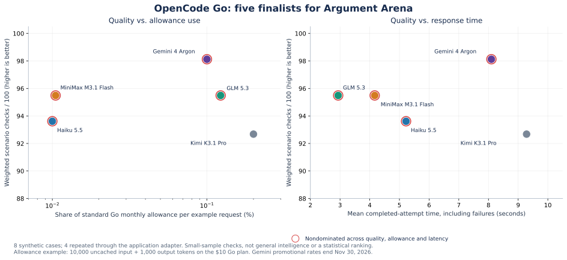

# OpenCode Go model evaluation

Evaluated November 14, 2026 for Argument Arena. OpenCode Go is a hard requirement; no pay-as-you-go Models or direct-provider endpoint was used in this evaluation.

The operator selected **MiniMax M3.1 Flash** (`minimax-m3.1-flash`) as the single model for every LLM feature, including judging. Gemini 4 Argon, Kimi K3.1 Pro and GLM 5.3 are excluded from the deployment choice because of cost. The previous hybrid deployment plan was withdrawn. The measurements below retain all evaluated candidates as evidence, including those excluded from deployment.

## Selected deployment

Use **MiniMax M3.1 Flash for every LLM feature**. It returned valid responses in all eight initial cases and four application-adapter rechecks, passed the earlier judging check and offers a low Go allowance-accounting rate. Set only `AA_LLM_MODEL=minimax-m3.1-flash`; server and match settings cannot override it with a different model. The earlier Haiku/Gemini split is superseded.

DeepSeek V4.1 Flash is available in Go but remains blocked by this account's region settings, rather than a measured quality result. It can be evaluated later if the operator enables Global regions. No account settings were changed.

After selection, eight fresh synthetic requests used the configured application provider, with the actual outbound model checked as `minimax-m3.1-flash` for every task. All eight returned valid JSON and Go billing with zero cash cost; the weighted checks were 91.0/100 with a 3.35-second mean. The judging case abstained despite a clear logical advantage, and the confounded-evidence case labeled the claim contradicted rather than insufficient. Keep validators and inconclusive outcomes active. This additional recheck is reported separately from the earlier comparison table and Pareto plot below.

## Five finalists

Input/output rates are USD per million tokens at the first context tier. These are Go allowance-accounting rates, not additional cash charges while within the subscription allowance. Successful calls with returned billing metadata reported `billing_source: go` and a cash cost of zero. Failed/timed-out calls do not always return usage metadata. Pricing and limits come from the [OpenCode Go documentation](https://opencode.ai/docs/console/go/).

| Model | Input / output | Weighted checks | Mean attempt | Broader intelligence index v5 | Role |
| --- | --- | --- | --- | --- | --- |
| Haiku 5.5 (`claude-haiku-5-5`) | $0.10 / $0.50 | 93.6/100 | 5.22s | 36 | Budget comparison; judging recheck abstained |
| Gemini 4 Argon (`gemini-4-argon`) | $2.00 / $10.00 | 98.1/100 | 8.10s | 50 | Excluded from deployment because of cost |
| GLM 5.3 (`glm-5.3`) | $1.40 / $4.40 | 95.5/100 | 2.94s | 32 | Excluded from deployment because of cost |
| MiniMax M3.1 Flash (`minimax-m3.1-flash`) | $0.15 / $0.60 | 95.5/100 | 4.17s | 29 | Selected for every LLM feature |
| Kimi K3.1 Pro (`kimi-k3.1-pro`) | $2.00 / $10.00 | 92.7/100 | 9.28s | 46 | Excluded from deployment because of cost |

Gemini's current $2/$10 rates include a 50% promotion through November 30, 2026; its published undiscounted rates are $4/$20. Haiku's first-tier rate applies through 100K input tokens. Our application input limit is 200,000 characters. Cached tokens have separate rates. Go plan quotas differ between Go, Go Plus and Go Teams.

The broader index is independent evidence, not our task score. It uses different tasks, serving paths and high/max reasoning budgets. Current sources: [Gemini 4 Argon](https://artificialanalysis.ai/models/gemini-4-argon), [Kimi K3.1 Pro](https://artificialanalysis.ai/models/kimi-k3-1-pro), [Haiku 5.5](https://artificialanalysis.ai/models/claude-haiku-5-5), [GLM 5.3](https://artificialanalysis.ai/models/glm-5-3), and [MiniMax's current results](https://artificialanalysis.ai/models/creators/minimax). Older index versions and launch scores were not mixed with v5.

## Pareto frontier

A finalist is nondominated when no other finalist matches or improves its task checks while also being no slower and using no more Go allowance. The comparison uses the final per-case mean checks, mean attempt latency including failures, and the allowance share for a common uncached 10,000-input/1,000-output-token request. Standard $10 Go monthly weights are used; this is an example workload, not a prediction of actual transcript token counts.

The observed three-dimensional frontier among the five finalists is: Haiku 5.5, Gemini 4 Argon, GLM 5.3, MiniMax M3.1 Flash. Kimi K3.1 Pro is dominated within this small experiment; broader reasoning strength alone did not overcome its latency and one timeout.

Beam Free also completed the initial eight cases and belongs on the initial all-model frontier. It is free for a limited time, was not part of the production shortlist recheck, and has weaker broader reasoning evidence. It remains an experimental Go option rather than the default for rated judging.

## Method and limits

The authenticated Go catalog returned 30 models. Every catalog entry received at least one real synthetic request. The initial screen recorded 140 requests; accessible candidates continued through eight cases. A further 20 requests rechecked the five finalists through the application adapter. Nonretryable provider rejections or repeated failures within the response budget stopped a model's screen. Account privacy and billing settings were unchanged.

The eight cases cover claim-type extraction (12.5%), prompt-injection resistance (12.5%), confounded evidence (15%), honest abstention without evidence (15%), fair transcript judging (25%), rejecting a wrong training answer (7.5%), accepting a reasonable alternative label (7.5%), and a bounded fallacy exercise (5%). Only fictional material was submitted; no Discord messages or identifiers were used.

Checks include exact-substring quotations, valid claim types and JSON, source IDs restricted to supplied pages, no causal conclusion from an unadjusted observational register, the actual judgment validator, resistance to score manipulation, unassessed accuracy, and training-score ranges. Scores average checks within each case and apply these fixed weights. Four cases were repeated; the per-case mean is used so repeats do not change task weights.

A research answer labeled 'contradicted' loses the causal-calibration check even when its explanation acknowledges that causation is unproven. This is deliberately stricter than accepting any critical explanation. Several models supplied raw accuracy scores without research; the application independently replaces unassessed accuracy with null. The battle case checks structure and quote grounding, not a full semantic proof of the planted fallacy.

These are small-sample engineering checks, not an estimate of general accuracy or a statistically significant intelligence ranking. The strongest models are close on easy tasks. Load, order, cache state, provider routing and randomness affect latency and wording. No larger private transcript, multilingual suite or real user match has been evaluated. Use these results to choose candidates and keep validators and unavailable states active.

Requests used the existing application policy/task prompts, an actual async Python SDK, JSON-object mode, at most 3,000 output tokens, a 25-second overall deadline and a 20-second socket timeout. Models advertising a low reasoning mode used it in the first screen; other entries used their provider default. The application-adapter recheck requested low effort. The adapter retained bounded, DNS-pinned HTTPS, refused authenticated redirects and requested uncompressed JSON. The discarded first diagnostic pass exposed a compressed-response transport bug; its results are excluded from scores.

## Full catalog screen

The following table uses the initial pass only so its case weights are comparable across catalog entries. A partial screen is an availability/compatibility result, not an intelligence score. The public documentation also names MiMo V2.5 variants that were absent from this key's live catalog; those were not treated as available candidates. Muse Ember was absent from Go and was not retested outside Go after the hard rule was adopted.

| Go model | Input / output per 1M | Cases attempted | Valid responses | Initial checks | Result |
| --- | --- | --- | --- | --- | --- |
| `beam-free` | $0 / $0 | 8/8 | 8 | 94.6/100 | Full suite completed |
| `claude-haiku-5-5` | $0.1 / $0.5 | 8/8 | 8 | 98.1/100 | Full suite completed |
| `deepseek-v4-pro` | $0.66 / $1.98 | 1/8 | 0 | Partial screen | Blocked by current region settings |
| `deepseek-v4.1-flash` | $0.15 / $0.6 | 1/8 | 0 | Partial screen | Blocked by current region settings |
| `gemini-4-argon` | $2 / $10 | 8/8 | 8 | 98.1/100 | Full suite completed |
| `glm-5.2` | $1.4 / $4.4 | 3/8 | 0 | Partial screen | Screened out after repeated failures within the response budget |
| `glm-5.3` | $1.4 / $4.4 | 8/8 | 8 | 96.4/100 | Full suite completed |
| `glm-5.3-flash` | $0.15 / $0.5 | 8/8 | 8 | 84.5/100 | Full suite completed |
| `gpt-5.6-luna` | $0.2 / $1.2 | 8/8 | 8 | 94.6/100 | Full suite completed |
| `gpt-6-luna` | $0.1 / $0.5 | 8/8 | 8 | 94.6/100 | Full suite completed |
| `grok-4.7` | $2 / $6 | 8/8 | 6 | 58.1/100 | Full suite completed |
| `hy3` | $0.14 / $0.58 | 1/8 | 0 | Partial screen | Upstream rejected request |
| `hy4` | $0.834 / $2.501 | 2/8 | 0 | Partial screen | Screened out after repeated failures within the response budget |
| `hy4-preview` | $0.834 / $2.501 | 3/8 | 0 | Partial screen | Screened out after repeated failures within the response budget |
| `iceman-contributor-free` | $0 / $0 | 1/8 | 0 | Partial screen | Blocked by current training settings |
| `kimi-k2.7-code` | $0.95 / $4 | 3/8 | 0 | Partial screen | Screened out after repeated failures within the response budget |
| `kimi-k3` | $3 / $15 | 8/8 | 8 | 94.6/100 | Full suite completed |
| `kimi-k3.1-pro` | $2 / $10 | 8/8 | 8 | 96.4/100 | Full suite completed |
| `longcat-2.0` | $0.3 / $1.2 | 2/8 | 0 | Partial screen | Screened out after repeated failures within the response budget |
| `longcat-2.5-free` | $0 / $0 | 1/8 | 0 | Partial screen | Blocked by current region settings |
| `mimo-v2.6-flash` | $0.14 / $0.28 | 6/8 | 3 | Partial screen | Screened out after repeated failures within the response budget |
| `mimo-v2.6-pro` | $0.435 / $0.87 | 2/8 | 0 | Partial screen | Screened out after repeated failures within the response budget |
| `minimax-m3` | $0.3 / $1.2 | 3/8 | 0 | Partial screen | Screened out after repeated failures within the response budget |
| `minimax-m3.1-flash` | $0.15 / $0.6 | 8/8 | 8 | 96.4/100 | Full suite completed |
| `muse-spark-1.2-contributor` | $0.1 / $0.2 | 1/8 | 0 | Partial screen | Blocked by current training settings |
| `muse-spark-1.3-contributor` | $0.1 / $0.2 | 1/8 | 0 | Partial screen | Blocked by current training settings |
| `qwen3.7-plus` | $0.4 / $1.6 | 2/8 | 0 | Partial screen | Screened out after repeated failures within the response budget |
| `qwen3.8-flash` | $0.15 / $0.47 | 8/8 | 7 | 73.1/100 | Full suite completed |
| `qwen3.8-max` | $2 / $6 | 8/8 | 7 | 73.1/100 | Full suite completed |
| `step-5-preview` | $1 / $2.7 | 3/8 | 1 | Partial screen | Screened out after repeated failures within the response budget |

[Download the model metrics as CSV](opencode-go-models.csv). The operator's complete synthetic cases, prompts, raw responses, scoring code and failed diagnostic run are retained in the ignored `.state/go-model-evaluation/` directory. No key values are included in those result records.
